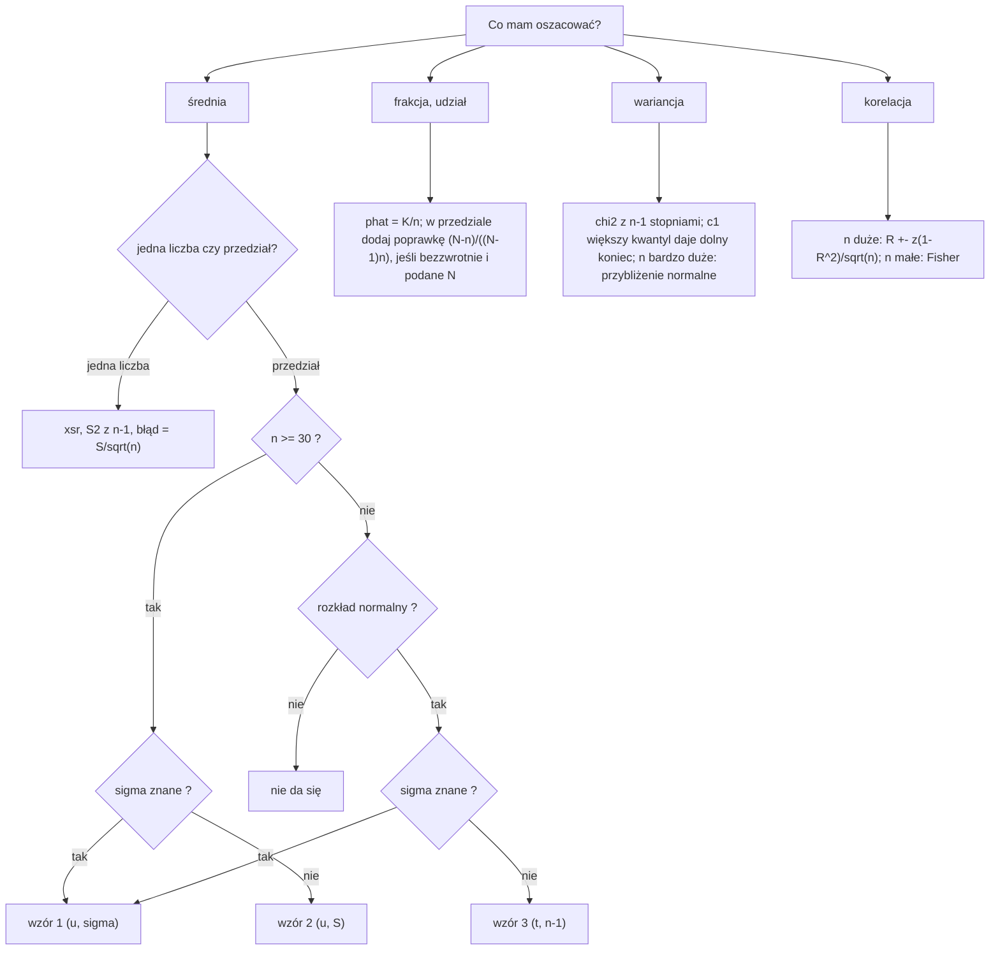

# 00 Ściąga - Statystyka
#statystyka #egzamin

Zakres: estymacja punktowa i przedziałowa (zadania z Excela). Pełne wzory i legenda: [[Wzory - estymacja]]. Teoria z wykładu: [[Estymacja punktowa]]. Hub: [[Statystyka matematyczna]].

**Oznaczenia:** $\text{xsr}$ średnia z próby; $S^2$ wariancja z dzielnikiem $n$; $\hat S^2$ z dzielnikiem $n-1$; $\hat p$ frakcja; $u$ kwantyl $N(0;1)$ rzędu $\frac{1+\gamma}{2}$; $t$ kwantyl $t$-Studenta ($n-1$ stopni swobody); $\Delta$ połowa długości przedziału; $\Delta_0$ dopuszczalna precyzja.

## Typy zadań

| Typ zadania | Po czym go poznać | Wzór | Funkcja Excela | Przykład |
|---|---|---|---|---|
| Ocena średniej | "oszacuj średnią", lista danych | $\text{xsr}=\frac{\sum x_i}{n}$ | `ŚREDNIA` | [[Estymacja punktowa - zadania#Zad.1]] |
| Ocena wariancji, odchylenia | "oszacuj wariancję", "odchylenie standardowe" | $\hat S^2=\frac{\sum(x_i-\text{xsr})^2}{n-1}$ | `WARIANCJA.PRÓBKI`, `ODCH.STANDARD.PRÓBKI` | [[Estymacja punktowa - zadania#Zad.2]] |
| Średni błąd szacunku średniej | "średni błąd szacunku dla estymatora średniej" | $\hat D(\text{xsr})=\sqrt{\hat S^2/n}$ | `PIERWIASTEK` | [[Estymacja punktowa - zadania#Zad.1]] |
| Frakcja punktowo i jej błąd | "frakcja", "udział", warunek (np. powyżej 100) | $\hat p=\frac Kn$, $\hat D=\sqrt{\hat p(1-\hat p)/n}$ | `LICZ.JEŻELI` | [[Estymacja punktowa - zadania#Zad.3]] |
| E, D2, MSE średniej (populacja znana) | "wartość oczekiwana i wariancja średniej z próby", "błąd średniokwadratowy" | $E(\text{xsr})=m$, $D^2=\frac{\sigma^2}{n}$, $\text{MSE}=D^2+b^2$ | `PIERWIASTEK` | [[Estymacja punktowa - zadania#Zad.4]] |
| Względny błąd średniej | "względny średni błąd szacunku" | $V=\frac{\sigma/\sqrt n}{m}$ | `PIERWIASTEK` | [[Estymacja punktowa - zadania#Zad.10]] |
| Minimalne $n$, estymacja punktowa | "minimalna liczebność", "błąd co najwyżej" | $n\ge\frac{\sigma^2}{D^2}$ ($\hat S^2$ jeśli $\sigma$ nieznane); frakcja $\frac{p(1-p)}{D^2}$, $p$ nieznane: $\frac{0{,}25}{D^2}$ | `ZAOKR.W.GÓRĘ` | [[Estymacja punktowa - zadania#Zad.6]] |
| Przedział średniej, $\sigma$ znane | "wiemy, że sigma = ..." | $\text{xsr}\pm u\frac{\sigma}{\sqrt n}$ | `ROZKŁ.NORMALNY.S.ODWR` | [[Estymacja przedziałowa 1 - rozwiązania#Zad.1]] |
| Przedział średniej, $\sigma$ nieznane, $n\ge30$ | "S^ = ...", duże $n$ | $\text{xsr}\pm u\frac{S}{\sqrt n}$ | `ROZKŁ.NORMALNY.S.ODWR` | [[Estymacja przedziałowa 1 - rozwiązania#Zad.4]] |
| Przedział średniej, $\sigma$ nieznane, $n<30$, rozkład normalny | "S^ = ...", małe $n$, "rozkład normalny" | $\text{xsr}\pm t\frac{S}{\sqrt{n-1}}$ | `ROZKŁ.T.ODWR.DS`, `ROZKŁ.T.ODWR` | [[Estymacja przedziałowa 1 - rozwiązania#Zad.2]] |
| Przedział frakcji | "udział", "frakcja", "ile z $n$ ..." | $\hat p\pm u\sqrt{\frac{\hat p(1-\hat p)}{n}}$ | `ROZKŁ.NORMALNY.S.ODWR` | [[Estymacja przedziałowa 1 - rozwiązania#Zad.6]] |
| Przedział frakcji, bez zwracania | "bezzwrotnie", podane $N$ | $\hat p\pm u\sqrt{\frac{N-n}{(N-1)n}\hat p(1-\hat p)}$ | `ROZKŁ.NORMALNY.S.ODWR` | [[Estymacja przedziałowa 3 - rozwiązania#Zad. 1]] |
| Przedział wariancji | "przedział dla wariancji", rozkład normalny | $\frac{(n-1)\hat S^2}{c_1}$ ; $\frac{(n-1)\hat S^2}{c_2}$ | `ROZKŁ.CHI.ODWR` | [[Estymacja przedziałowa 2 - rozwiązania#Zad. 2]] |
| Przedział wariancji, duża próba | $n$ bardzo duże (ok. 100 i więcej) | $\frac{(n-1)\hat S^2}{n-1\pm z\sqrt{2(n-1)}}$ | `ROZKŁ.NORMALNY.S.ODWR` | [[Estymacja przedziałowa 2 - rozwiązania#Zad. 3]] |
| Przedział korelacji, duża próba | "współczynnik korelacji", duże $n$ | $R\pm z\frac{1-R^2}{\sqrt n}$ | `WSP.KORELACJI` ($R$ z danych) | [[Estymacja przedziałowa 2 - rozwiązania#Zad. 4]] |
| Przedział korelacji, mała próba | "współczynnik korelacji", małe $n$ | Fisher: $A=U_n\pm\frac{v}{\sqrt{n-3}}$, potem $\frac{e^{2A}-1}{e^{2A}+1}$ | `LN`, `EXP`, `ROZKŁAD.FISHER.ODW` | [[Estymacja przedziałowa 2 - rozwiązania#Zad. 5]] |
| Wskaźnik precyzji | "wskaźnik precyzji estymacji" | $\Delta=\frac{T_2-T_1}{2}$, $\delta=\frac{\Delta}{\text{estymator}}$ | zwykłe działania | [[Estymacja przedziałowa 1 - rozwiązania]] |
| Minimalne $n$ dla przedziału średniej | "wskaźnik precyzji nie większy niż", "minimalna liczebność" | $\sigma$ znane: $\frac{\sigma^2u^2}{\Delta_0^2}$; nieznane: $\frac{\hat S^2t^2}{\Delta_0^2}$ | `ZAOKR.W.GÓRĘ` | [[Estymacja przedziałowa 2 - rozwiązania#Zad. 1]], [[Estymacja przedziałowa 1 - zadania#Zad.8]] |
| Minimalne $n$ dla przedziału frakcji | to samo, ale frakcja | $\frac{\hat p(1-\hat p)u^2}{\Delta_0^2}$ | `ZAOKR.W.GÓRĘ` | [[Estymacja przedziałowa 1 - zadania#Zad.9]] |
| Minimalne $n$ dla frakcji, bez zwracania | "bezzwrotnie", $N$ znane | $\left(\frac1N+\frac{\Delta_0^2(N-1)}{Nz^2\hat p(1-\hat p)}\right)^{-1}$ | `ZAOKR.W.GÓRĘ` | [[Estymacja przedziałowa 3 - rozwiązania#Zad. 2]] |

## Wszystkie wzory według tematów
(skrót; objaśnienia i przykłady w [[Wzory - estymacja]])

**Miary położenia**

$$\text{xsr}=\frac{1}{n}\sum x_i$$

**Miary zmienności**

$$S^2=\frac{1}{n}\sum(x_i-\text{xsr})^2\qquad\hat S^2=\frac{1}{n-1}\sum(x_i-\text{xsr})^2=\frac{n}{n-1}S^2\qquad S=\hat S\sqrt{\frac{n-1}{n}}$$

**Własności estymatora**

$$b=E(T_n)-\theta\qquad\text{MSE}=D^2(T_n)+b^2\qquad D^2(\text{xsr})=\frac{\sigma^2}{n}\qquad\hat D(\text{xsr})=\frac{\hat S}{\sqrt n}$$

$$\hat p=\frac{K}{n}\qquad D^2(\hat p)=\frac{p(1-p)}{n}\qquad\hat D(\hat p)=\sqrt{\frac{\hat p(1-\hat p)}{n}}\qquad V=\frac{D(\text{xsr})}{m}$$

**Przedziały ufności**

$$m:\ \ \text{xsr}\pm u\frac{\sigma}{\sqrt n}\ \ \ \text{lub}\ \ \ \text{xsr}\pm u\frac{S}{\sqrt n}\ (n\ge30)\ \ \ \text{lub}\ \ \ \text{xsr}\pm t\frac{S}{\sqrt{n-1}}\ (n<30)$$

$$p:\ \ \hat p\pm u\sqrt{\frac{\hat p(1-\hat p)}{n}}\ \ \ \text{lub (bez zwracania)}\ \ \ \hat p\pm u\sqrt{\frac{N-n}{(N-1)n}\hat p(1-\hat p)}$$

$$\sigma^2:\ \ \left(\frac{(n-1)\hat S^2}{c_1};\ \frac{(n-1)\hat S^2}{c_2}\right)\qquad\rho:\ \ R\pm z\frac{1-R^2}{\sqrt n}\ \ \text{lub Fisher}$$

$$\Delta=\frac{T_2-T_1}{2}\qquad\delta=\frac{\Delta}{\text{estymator}}$$

**Liczebność próby (zawsze w górę)**

$$n\ge\frac{\sigma^2}{D^2}\qquad n\ge\frac{p(1-p)}{D^2}\qquad n\ge\frac{\sigma^2u^2}{\Delta_0^2}\qquad n\ge\frac{\hat S^2t^2}{\Delta_0^2}\qquad n\ge\frac{\hat p(1-\hat p)u^2}{\Delta_0^2}$$

$$n\ge\left(\frac1N+\frac{\Delta_0^2(N-1)}{Nz^2\hat p(1-\hat p)}\right)^{-1}$$

**Regresja i testy** nie występują w tych plikach (brak zadań), więc ich tu nie dopisuję. Dojdą z kolejnych materiałów (regresja: `REGLINP`).

## Schemat decyzyjny: mam takie dane lub polecenie, więc stosuję to

**"Minimalna liczebność":**
- z estymacji punktowej ("średni błąd co najwyżej") stosuję $n\ge\frac{\sigma^2}{D^2}$ lub $\frac{p(1-p)}{D^2}$;
- z przedziału ("wskaźnik precyzji nie większy niż $\Delta_0$", $\gamma$) dodaję kwantyl $u$ albo $t$;
- $\sigma$ znane: $u$; $\sigma$ nieznane: $\hat S$ i $t$; $p$ nieznane: $p=0{,}5$; "bezzwrotnie": wzór z $N$.

**"Wskaźnik precyzji":** $\Delta$ to połowa długości przedziału; względny $=\Delta/\text{estymator}$.

**Zawsze na końcu:** zaokrąglij $n$ w górę, sprawdź $n$ kontra $n-1$, napisz interpretację zdaniem.

## Szablony interpretacji (egzamin)
- Przedział: "Z ufnością $\gamma$ przedział $(a;\,b)$ pokrywa nieznaną [średnią / frakcję / wariancję / korelację] w populacji."
- $\Delta$: "Maksymalny błąd oszacowania wynosi $\Delta$ (w jednostkach danych), czyli $\delta\%$ oszacowania."
- $\hat D$: "Szacunek średnio odchyla się od prawdziwej wartości o $\hat D$."
- Liczebność: "Aby precyzja nie była gorsza niż $\Delta_0$ przy ufności $\gamma$, trzeba zbadać co najmniej $n$ jednostek."

## Notatki z zadaniami
- [[Estymacja punktowa - zadania]] (`Estymacja_punktowa.xlsx`)
- [[Estymacja przedziałowa 1 - rozwiązania]] i [[Estymacja przedziałowa 1 - zadania]]
- [[Estymacja przedziałowa 2 - rozwiązania]]
- [[Estymacja przedziałowa 3 - rozwiązania]] i [[Estymacja przedziałowa 3 - zadania]]
