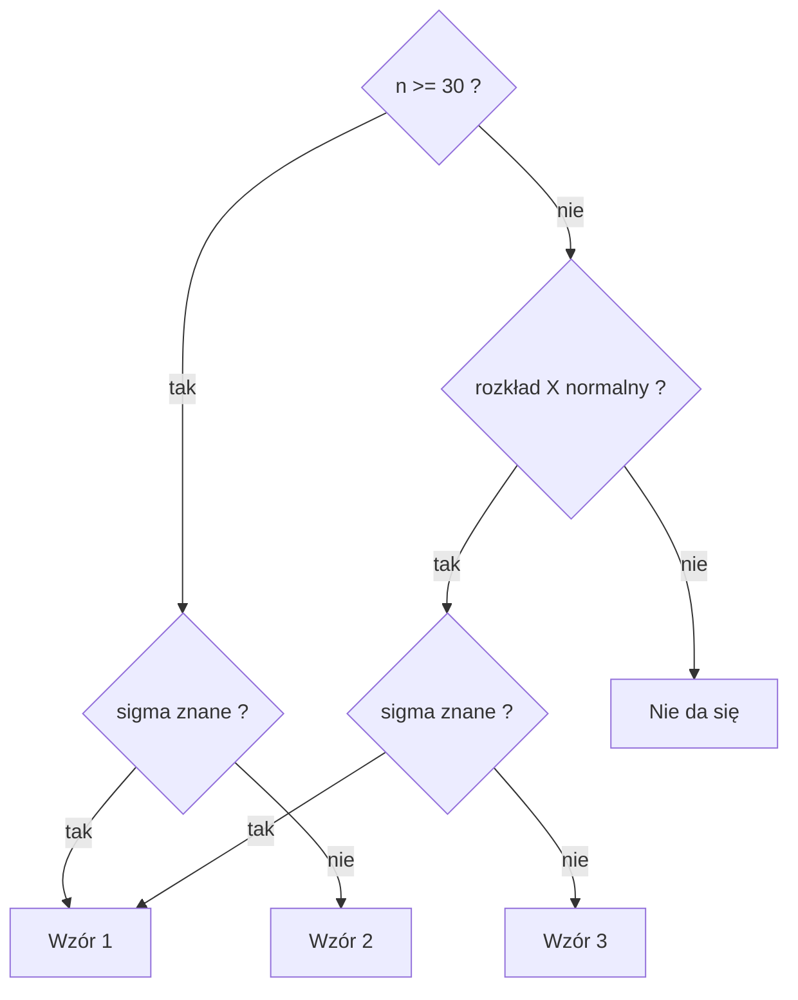

# Wzory - estymacja
#statystyka #egzamin

Jedno miejsce na wszystkie wzory z zadań w Excelu (włącznie ze wzorami ze zdjęć wklejonych w arkusze). Notatki z zadań linkują tutaj. Skrót na egzamin: [[00 Ściąga - Statystyka]]. Teoria z wykładu: [[Estymacja punktowa]].

## Oznaczenia

| Zapis | Znaczenie |
|---|---|
| $\text{xsr}$ | średnia z próby |
| $m$, $\sigma$ | średnia i odchylenie standardowe w populacji |
| $S^2$ | wariancja z próby z dzielnikiem $n$ (obciążona), $S=\sqrt{S^2}$ |
| $\hat S^2$ | wariancja z próby z dzielnikiem $n-1$ (nieobciążona), $\hat S=\sqrt{\hat S^2}$ |
| $\hat p$ | frakcja z próby, $\hat p = K/n$ |
| $\gamma$ | poziom ufności (np. 0,95) |
| $u_\gamma$, $t_\gamma$ | kwantyle rozkładu normalnego $N(0;1)$ i $t$-Studenta |
| $\Delta$ | wskaźnik precyzji (połowa długości przedziału) |
| $\Delta_0$ | najwyższy dopuszczalny wskaźnik precyzji |

## Średnia i wariancja z próby

$$\text{xsr}=\frac{1}{n}\sum_{i=1}^{n}x_i$$

$$S^2=\frac{1}{n}\sum_{i=1}^{n}(x_i-\text{xsr})^2 \qquad\qquad \hat S^2=\frac{1}{n-1}\sum_{i=1}^{n}(x_i-\text{xsr})^2=\frac{n}{n-1}\,S^2$$

Przeliczenie: $S=\hat S\sqrt{\dfrac{n-1}{n}}$ (tak liczone w arkuszach: PIERWIASTEK(164/165)*5542).

## Estymacja punktowa

- Błąd estymacji: $U=T_n-\theta$; obciążenie: $b=E(T_n)-\theta$ (estymator nieobciążony: $b=0$).
- Błąd średniokwadratowy: $E(U^2)=D^2(T_n)+b^2$; jego pierwiastek (RMSE) to średnie odchylenie estymatora od $\theta$.
- Błąd średni szacunku parametru: $\sqrt{E(U^2)}$. (Na slajdzie zapisano $\sqrt{E(U)^2}$, to pewnie literówka. Poprawnie jest $E(U^2)$.)
- Średnia z próby: $D^2(\text{xsr})=\dfrac{\sigma^2}{n}$, $\;D(\text{xsr})=\dfrac{\sigma}{\sqrt n}$.
- Ocena z próby ($\sigma$ nieznane): $\hat D^2(\text{xsr})=\dfrac{\hat S^2}{n}$, $\;\hat D(\text{xsr})=\dfrac{\hat S}{\sqrt n}$.
- Frakcja: $\hat p=\dfrac{K_n}{n}$, $\;D^2(\hat p)=\dfrac{p(1-p)}{n}$, $\;\hat D^2(\hat p)=\dfrac{\hat p(1-\hat p)}{n}$.
- Względny błąd średni: $V=\dfrac{D(\text{xsr})}{m}$ (razy 100%).

## Przedział dla średniej

Szukamy przedziału dla $m=E(X)$. Ze slajdu mamy trzy wzory:

| Wzór | Kiedy | Przedział |
|---|---|---|
| 1 | $\sigma$ znane | $\text{xsr}\pm u_\gamma\dfrac{\sigma}{\sqrt n}$ |
| 2 | $\sigma$ nieznane, $n\ge 30$ | $\text{xsr}\pm u_\gamma\dfrac{S}{\sqrt n}$ |
| 3 | $\sigma$ nieznane, $n<30$, rozkład normalny | $\text{xsr}\pm t_\gamma\dfrac{S}{\sqrt{n-1}}$ |

Liczby $u_\gamma$ i $t_\gamma$ wybieramy tak, żeby: dla $U\sim N(0;1)$ zachodziło $P(-u_\gamma<U<u_\gamma)=\gamma$, a dla $T\sim t_{n-1}$ zachodziło $P(-t_\gamma<T<t_\gamma)=\gamma$. Czyli $u_\gamma$ i $t_\gamma$ to kwantyle rzędu $\frac{1+\gamma}{2}$.

Uwaga: w tych wzorach $S$ ma dzielnik $n$. Wzór 3 jest równoważny $\text{xsr}\pm t_\gamma\dfrac{\hat S}{\sqrt n}$.

### Który wzór

### Kwantyle: jaki argument wpisać

| $\gamma$ | rząd kwantyla $\frac{1+\gamma}{2}$ | $u_\gamma$ |
|---|---|---|
| 0,80 | 0,90 | 1,2816 |
| 0,90 | 0,95 | 1,6449 |
| 0,92 | 0,96 | 1,7507 |
| 0,95 | 0,975 | 1,9600 |
| 0,99 | 0,995 | 2,5758 |

## Wskaźnik precyzji

Wskaźnik precyzji estymacji przedziałowej to połowa rozpiętości przedziału ufności $(T_1;\,T_2)$:

$$\Delta=\frac{1}{2}\,(T_2-T_1) \qquad\qquad \text{względny: } \delta=\frac{\Delta}{\text{estymator}}$$

(estymatorem jest $\text{xsr}$ albo $\hat p$).

## Przedział dla frakcji

Duża próba (ze slajdu), $U_n\sim N(0;1)$, $P(|U_n|\le u_\gamma)=\gamma$:

$$\hat p-u_\gamma\sqrt{\frac{\hat p(1-\hat p)}{n}}\;\le\; p\;\le\;\hat p+u_\gamma\sqrt{\frac{\hat p(1-\hat p)}{n}}$$

Losowanie bez zwracania z populacji o liczebności $N$ (z poprawką na skończoność populacji; $P(|Z|<z_\gamma)=\gamma$):

$$\hat p\pm z_\gamma\sqrt{\frac{N-n}{(N-1)\,n}\;\hat p(1-\hat p)}$$

## Przedział dla wariancji

Rozkład normalny. Zmienna $U_{n-1}=\dfrac{nS^2}{\sigma^2}=\dfrac{(n-1)\hat S^2}{\sigma^2}$ ma rozkład $\chi^2_{n-1}$. Przedział $P(T_{1n}<\sigma^2<T_{2n})=\gamma$:

$$T_{1n}=\frac{(n-1)\hat S^2}{c_1}=\frac{nS^2}{c_1}\qquad T_{2n}=\frac{(n-1)\hat S^2}{c_2}=\frac{nS^2}{c_2}$$

$c_1$ i $c_2$ to kwantyle rozkładu $\chi^2_{n-1}$ rzędów $\frac{1+\gamma}{2}$ i $\frac{1-\gamma}{2}$, czyli $P(U_{n-1}<c_1)=\frac{1+\gamma}{2}$ i $P(U_{n-1}<c_2)=\frac{1-\gamma}{2}$. Większy kwantyl $c_1$ w mianowniku daje **dolny** koniec przedziału.

Duża próba (przybliżenie normalne), $P(Z<z_\gamma)=\frac{1+\gamma}{2}$, $Z\sim N(0;1)$:

$$T_{*1n}=\frac{(n-1)\hat S^2}{n-1+z_\gamma\sqrt{2(n-1)}}\qquad T_{*2n}=\frac{(n-1)\hat S^2}{n-1-z_\gamma\sqrt{2(n-1)}}$$

## Przedział dla korelacji

Rozkład normalny cech, $\rho$ = współczynnik korelacji w populacji, $R$ z próby.

Duża próba ($Z\sim N(0;1)$, $P(Z<z_\gamma)=\frac{1+\gamma}{2}$):

$$T_{1n}=R-z_\gamma\frac{1-R^2}{\sqrt n}\qquad T_{2n}=R+z_\gamma\frac{1-R^2}{\sqrt n}$$

Mała próba, umiarkowana liczebność (transformacja Fishera), $V\sim N(0;1)$, $P(|V|<v_\gamma)=\gamma$:

$$U_n=\frac{1}{2}\ln\frac{1+R}{1-R}\qquad A_{1n}=U_n-\frac{v_\gamma}{\sqrt{n-3}}\qquad A_{2n}=U_n+\frac{v_\gamma}{\sqrt{n-3}}$$

$$T_{1*n}=\frac{e^{2A_{1n}}-1}{e^{2A_{1n}}+1}\qquad T_{2*n}=\frac{e^{2A_{2n}}-1}{e^{2A_{2n}}+1}$$

## Niezbędna liczebność próby

Zawsze szukamy najmniejszego **całkowitego** $n$ (zaokrąglenie w górę).

Estymacja punktowa (błąd średni nie większy niż $d$):

$$n\ge\frac{\sigma^2}{d^2}\qquad n\ge\frac{\hat S^2}{d^2}\ (\sigma\text{ nieznane})\qquad n\ge\frac{p(1-p)}{d^2}\qquad n\ge\frac{0{,}25}{d^2}\ (p\text{ nieznane})$$

Skrypt z wykładu ma jeszcze "+1" (patrz [[Estymacja punktowa - zadania#Pułapki]]).

Estymacja przedziałowa ($\Delta\le\Delta_0$):

| Sytuacja | Warunek | Wzór na $n$ |
|---|---|---|
| średnia, $\sigma$ znane | $\dfrac{\sigma}{\sqrt n}z_\gamma\le\Delta_0$ | $n\ge\dfrac{\sigma^2}{\Delta_0^2}\,z_\gamma^2$ |
| średnia, $\sigma$ nieznane | $\dfrac{\hat S}{\sqrt n}t_\gamma\le\Delta_0$ | $n\ge\dfrac{\hat S^2}{\Delta_0^2}\,t_\gamma^2$ ($P(\lvert T_{n-1}\rvert<t_\gamma)=\gamma$) |
| frakcja | $\sqrt{\dfrac{\hat p(1-\hat p)}{n}}\,u_\gamma\le\Delta_0$ | $n\ge\dfrac{\hat p(1-\hat p)}{\Delta_0^2}\,u_\gamma^2$ |
| frakcja, bez zwracania z $N$ | | $n\ge\left(\dfrac{1}{N}+\dfrac{\Delta_0^2(N-1)}{N\,z_\gamma^2\,\hat p(1-\hat p)}\right)^{-1}$ |

## Funkcje Excela po polsku

W polskim Excelu argumenty rozdzielamy średnikiem, a ułamki zapisujemy z przecinkiem. Nazwy wg [strony Microsoft](https://support.microsoft.com/pl-pl/Excel/statistical-functions-reference); **zweryfikuj w swoim Excelu** (Wstaw funkcję, szukaj fragmentu nazwy).

| Co liczymy | Funkcja |
|---|---|
| średnia | `ŚREDNIA` |
| suma | `SUMA` |
| wariancja z próby ($n-1$) | `WARIANCJA.PRÓBKI` (w zad.1 użyto `WARIANCJA.A`, dla liczb to samo) |
| odchylenie standardowe z próby ($n-1$) | `ODCH.STANDARD.PRÓBKI` |
| wariancja / odchylenie populacji ($n$) | `WARIANCJA.POP` / `ODCH.STAND.POPUL` |
| pierwiastek | `PIERWIASTEK` |
| liczba komórek spełniających warunek | `LICZ.JEŻELI` |
| zaokrąglenie w górę | `ZAOKR.W.GÓRĘ` |
| $u_\gamma$: kwantyl $N(0;1)$ | `ROZKŁ.NORMALNY.S.ODWR(rząd)` |
| $t_\gamma$, argument jednostronny $\frac{1+\gamma}{2}$ | `ROZKŁ.T.ODWR(rząd; n-1)` |
| $t_\gamma$, argument dwustronny $1-\gamma$ | `ROZKŁ.T.ODWR.DS(1-gamma; n-1)` |
| kwantyl $\chi^2$ | `ROZKŁ.CHI.ODWR(rząd; n-1)` |
| korelacja z danych | `WSP.KORELACJI` |
| tanh (odwrotna transformacja Fishera) | `ROZKŁAD.FISHER.ODW` |
| logarytm naturalny, $e^x$ | `LN`, `EXP` |

Uwaga: w arkuszu zad.2 (przedziałowa 1) kwantyl $t$ jest policzony funkcją z argumentem **dwustronnym** (0,08 dla 92%), a w przedziałowej 2 (zad.1) funkcją z argumentem **jednostronnym** (0,975 dla 95%). Wynik ten sam, argument inny. Kwantyl $\chi^2$ jest lewostronny: $c_1$ = rząd 0,975, $c_2$ = rząd 0,025.
